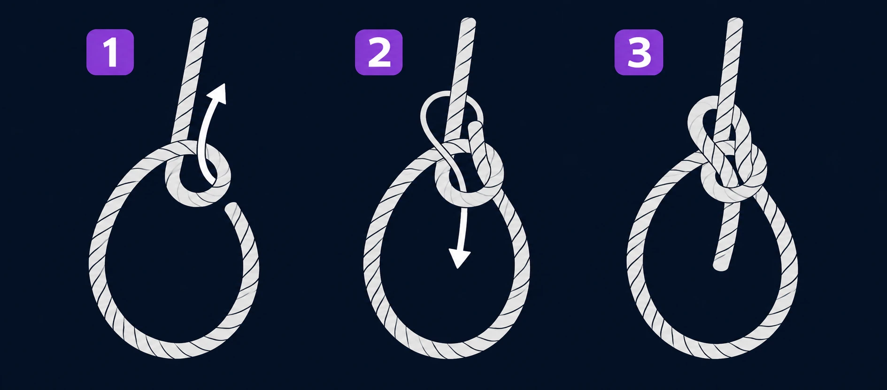
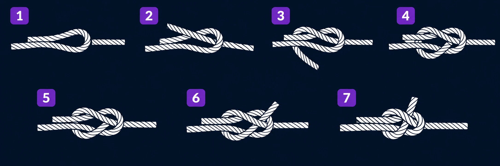
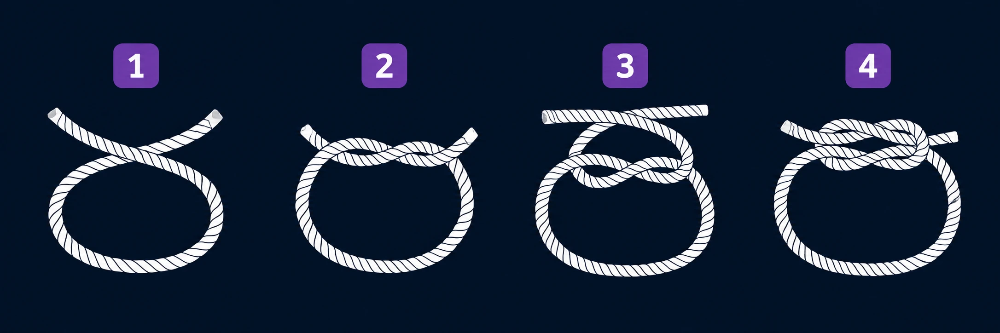
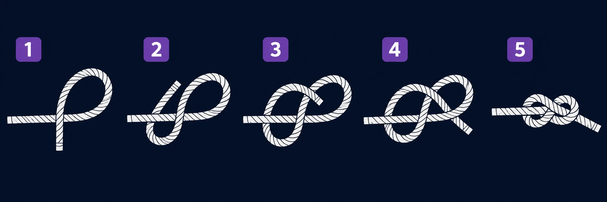
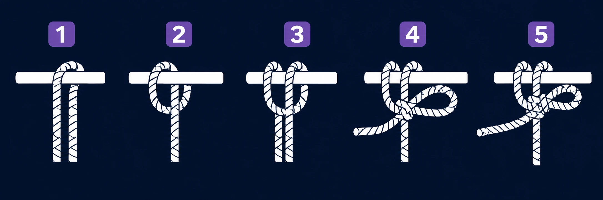

# 🧵 Nós

## ⚓ Lais de guia

Forma uma alça fixa para prender um cabo a um ponto de ancoragem.

## 🔗 Nó de escota

Une dois cabos, inclusive quando têm espessuras diferentes.

## 🧵 Nó direito

Une pontas de cabos de espessura parecida em tarefas leves. Pode escorregar com carga irregular; não use para sustentar peso.

## 🔒 Nó oito

Cria um nó de batente na ponta do cabo para evitar que ele passe por uma abertura.

## 📍 Volta do fiel

Prende um cabo a um poste e pode iniciar uma amarração. Pode afrouxar se a carga mudar.

Use esses nós em tarefas simples de acampamento, não para escalada, resgate ou sustentação de pessoas.
