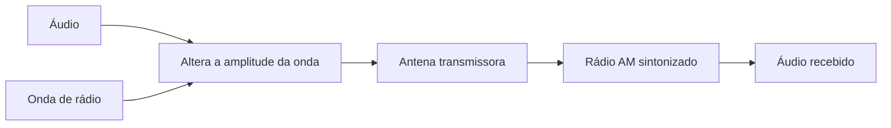

# 📻 AM

AM significa **modulação em amplitude**. O transmissor varia a intensidade da onda para carregar o áudio; a frequência da onda fica quase constante.

Nesta tabela, AM se refere às emissoras em **ondas médias**, na faixa de 525 a 1.705 kHz.

### 📡 Como funciona

Rádios AM podem alcançar distâncias grandes, especialmente à noite, mas ruídos elétricos e estática costumam atrapalhar a recepção.

### 📻 Emissoras na Bahia e em Minas Gerais

#### Bahia

| Emissora | Cidade | Frequência | Alcance conhecido |
| --- | --- | --- | --- |
| Rádio Bahiana | Ilhéus | 1.310 kHz | Ilhéus e região |
| Rádio Cruzeiro | Salvador | 590 kHz | A emissora informa cobertura ampla na Bahia; a recepção varia por local |
| Rádio Difusora | Itabuna | 640 kHz | Itabuna e região sul da Bahia |
| Rádio Jornal | Itabuna | 560 kHz | Itabuna e região |
| Rede Aleluia | Ilhéus | 690 kHz | Ilhéus e região |

#### Minas Gerais

| Emissora | Cidade | Frequência | Alcance conhecido |
| --- | --- | --- | --- |
| Rádio Inconfidência | Belo Horizonte | 880 kHz | Região metropolitana durante o dia; cerca de 150 km à noite |

O sinal muda com o horário, relevo, interferência e aparelho. Em ondas médias, emissoras distantes podem aparecer à noite, mas isso não é garantido em todo município.

### 🔎 Sintonia

Escolha uma frequência AM no rádio e ajuste a antena conforme o aparelho. Em rádios portáteis, girar o aparelho pode mudar a recepção, pois a antena interna costuma ser direcional.
