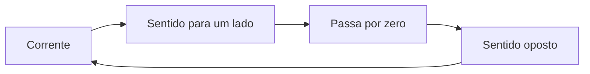

# 〰️ CA

Na corrente alternada, o sentido da corrente muda repetidamente. A eletricidade das tomadas é CA; geradores também podem produzi-la.

### 🔄 Como varia

Essa variação forma ciclos. A frequência, medida em hertz (Hz), indica quantos ciclos acontecem por segundo. A tensão também varia ao longo de cada ciclo.

### 🔋 Onde aparece

- Tomadas e instalações de casas.
- Saída de muitos geradores.
- Transformadores, que podem alterar a tensão CA.

### ↔️ CA e CC

Um aparelho alimentado por pilhas usa corrente contínua (CC). Um adaptador pode converter a CA da tomada em CC para alimentar esse aparelho.

### ⚠️ Segurança

A tensão da rede elétrica pode causar choque fatal e incêndio. Não abra tomadas, fontes ou aparelhos ligados à rede; use equipamentos próprios e procure alguém qualificado para instalações.
