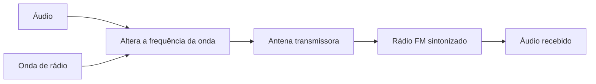

# 📻 FM

FM significa **modulação em frequência**. O transmissor varia ligeiramente a frequência da onda para carregar o áudio, mantendo a amplitude quase constante.

### 📡 Como funciona

FM costuma ter som mais limpo e sofrer menos com estática. Em geral, depende mais de alcance direto: morros, prédios e a curvatura da Terra podem bloquear o sinal.

### 📻 Emissoras na Bahia e em Minas Gerais

As emissoras abaixo são exemplos de Salvador e Belo Horizonte. O sinal pode alcançar cidades próximas, mas varia conforme relevo, antena e local de escuta.

#### Bahia

| Emissora | Cidade | Frequência | Alcance estimado |
| --- | --- | --- | --- |
| Bahia FM | Salvador | 88,7 MHz | Salvador e entorno |
| Educadora FM | Salvador | 107,5 MHz | Salvador e entorno |
| Itapoan FM | Salvador | 97,5 MHz | Salvador e entorno |

#### Minas Gerais

| Emissora | Cidade | Frequência | Alcance estimado |
| --- | --- | --- | --- |
| 98 Live FM | Belo Horizonte | 98,3 MHz | Belo Horizonte e entorno |
| BandNews FM | Belo Horizonte | 89,5 MHz | Belo Horizonte e entorno |
| BH FM | Belo Horizonte | 102,1 MHz | Belo Horizonte e entorno |
| Inconfidência FM | Belo Horizonte | 100,9 MHz | Belo Horizonte e parte da região metropolitana |
| Itatiaia FM | Belo Horizonte | 95,7 MHz | Belo Horizonte e entorno |

### 🔎 Sintonia

Selecione a faixa FM e ajuste a frequência. Mover o rádio ou estender sua antena pode melhorar a recepção; antenas telescópicas costumam funcionar melhor quando estendidas.
