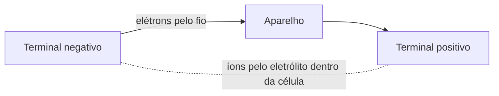
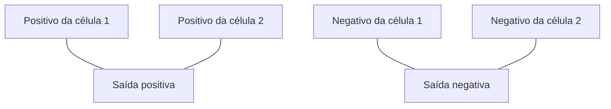

# 🔋 Bateria

Uma bateria guarda energia em reações químicas e entrega energia elétrica quando ligada a um circuito fechado. Uma bateria pode ter uma ou várias células.

### ⚡ Como funciona

Cada célula tem dois eletrodos e um eletrólito. Durante a descarga, a reação química faz elétrons saírem pelo fio e atravessarem o aparelho; dentro da célula, íons se movem pelo eletrólito para manter o equilíbrio.

O **volt (V)** indica a tensão disponível. **mAh** ou **Ah** indicam quanta carga a bateria pode fornecer ao longo do tempo; **Wh** é uma medida de energia. O aparelho precisa aceitar a tensão e o tipo de bateria corretos.

### 🔗 Ligações

**Em série**, o positivo de uma célula liga ao negativo da próxima. As tensões se somam; a capacidade em Ah continua parecida com a de uma célula.

**Em paralelo**, positivos ficam juntos e negativos ficam juntos. A tensão continua a de uma célula; a capacidade pode aumentar.

Não misture baterias diferentes ou com cargas e desgastes diferentes numa ligação. Para montar um conjunto recarregável, use células compatíveis e um circuito de proteção e carregador próprios.

### 🧪 Tipos comuns

- **Alcalina:** descartável; comum em controles, lanternas e rádios pequenos. Não recarregue.
- **NiMH:** recarregável; usada em formatos como AA. Precisa de carregador compatível.
- **Íon de lítio:** leve e com boa capacidade; exige proteção contra carga, descarga e curto-circuito.
- **Chumbo-ácido:** pesada, comum em veículos e sistemas estacionários; pode liberar gases durante a carga e contém ácido corrosivo.

### 🧰 Uso e cuidado

- Confira a tensão, o formato e a polaridade indicados no aparelho.
- Não encoste os terminais com metal: curto-circuito pode aquecer muito a bateria.
- Não abra, perfure, esmague, queime ou tente recarregar uma bateria que não seja recarregável.
- Não use bateria inchada, quente, rachada ou vazando. Evite tocar no líquido e mantenha-a longe de fogo.
- Guarde em local fresco e seco, com os terminais protegidos de objetos metálicos. Leve baterias usadas a um ponto de coleta.
