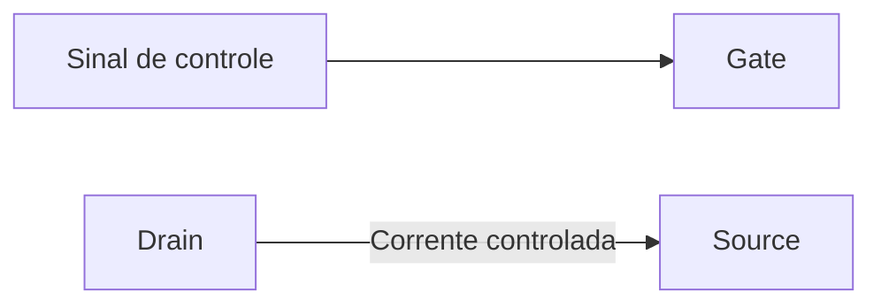

# 🔌 MOSFET

MOSFET é um tipo de transistor controlado pela tensão aplicada ao terminal **Gate**. Ele pode funcionar como chave eletrônica ou, em circuitos próprios, controlar sinais.

### 📍 Terminais

- **Gate (G):** recebe o sinal de controle.
- **Drain (D):** terminal por onde a corrente entra ou sai, conforme o tipo e a ligação.
- **Source (S):** referência da tensão de controle e outro caminho da corrente.

### 🔁 Como funciona

Em um MOSFET de canal N, uma tensão suficiente entre Gate e Source permite a condução entre Drain e Source. No canal P, a polaridade de controle é oposta. O valor de tensão indicado como **VGS(th)** marca o início da condução; não significa que o componente já esteja totalmente ligado.

### 🧰 Usos comuns

- Ligar e desligar cargas com um sinal de baixa potência.
- Controlar motores, luzes e conversores em circuitos apropriados.
- Comutar sinais em equipamentos eletrônicos.

### ⚠️ Cuidados

- Escolha o componente para a tensão, a corrente e a potência da carga.
- Confira se ele é de **nível lógico** quando o controle vem de um microcontrolador; nem todo MOSFET liga bem com 3,3 V ou 5 V no Gate.
- A entrada Gate é sensível à eletricidade estática. Evite tocar nos terminais sem necessidade e guarde o componente em embalagem adequada.
- Use um resistor de Gate ou outros componentes de controle quando o circuito exigir; a carga capacitiva do Gate pode causar comutação indesejada.
- Desligue a alimentação antes de alterar as ligações.
