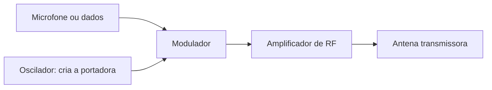
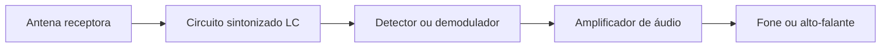

# 📻 Rádio

O rádio leva voz ou dados por ondas eletromagnéticas. O transmissor coloca a informação numa onda portadora e a antena a irradia; o receptor capta uma parte dessa onda, seleciona o sinal desejado e recupera a informação.

### 📡 Transmissor

- **Microfone ou entrada de dados:** fornece a informação a enviar.
- **Oscilador:** gera uma onda de rádio estável, chamada portadora.
- **Modulador:** combina a informação com a portadora. Em AM, varia a amplitude; em FM, varia a frequência.
- **Amplificador de RF:** aumenta o sinal antes de enviá-lo à antena.
- **Antena:** transforma o sinal elétrico em ondas que se propagam pelo espaço.

### 🎧 Receptor

- **Antena receptora:** capta sinais de várias estações ao mesmo tempo.
- **Circuito LC:** bobina e capacitor formam um filtro ajustável que favorece uma faixa de frequência. Ajustar esse circuito é sintonizar a estação.
- **Detector ou demodulador:** separa a voz ou os dados da portadora.
- **Amplificador de áudio:** aumenta o sinal recuperado para mover o fone ou alto-falante.

### 🔄 Como a informação viaja

O som do microfone vira um sinal elétrico. O transmissor usa esse sinal para modular a portadora; a antena o irradia como ondas de rádio. No receptor, a antena capta as ondas, o circuito LC seleciona uma estação e o demodulador recupera o som.

AM e FM descrevem maneiras de modular a portadora. O diagrama é funcional, não um esquema de montagem: transmitir exige projeto adequado e uso de frequências autorizado para evitar interferência em outros serviços.
