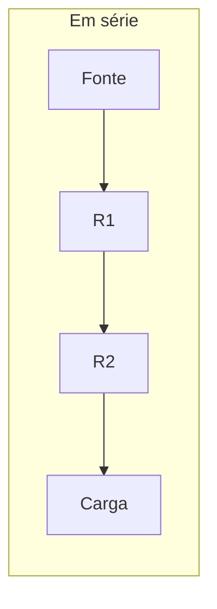

# 🔌 Resistência

**Resistência elétrica** é a oposição à passagem da corrente. Ela é medida em **ohms (Ω)**. O **resistor** é o componente usado para limitar ou controlar a corrente em um circuito.

### ⚙️ Para que serve

- Limitar a corrente para proteger componentes, como LEDs.
- Dividir tensão entre partes de um circuito.
- Transformar parte da energia elétrica em calor.
- Ajustar sinais e tempos em circuitos eletrônicos.

### 🧮 Relação entre tensão, corrente e resistência

A Lei de Ohm relaciona as três grandezas:

```text
Tensão (V) = Corrente (A) × Resistência (Ω)
```

Para estimar a corrente, divida a tensão pela resistência. Por exemplo, 9 V aplicados a 1.000 Ω resultam em cerca de 0,009 A, ou 9 mA.

### 🔗 Em série e em paralelo



Em série, os valores de resistência se somam. Em paralelo, a resistência equivalente diminui; adicionar outro caminho em paralelo permite que mais corrente passe pela fonte.

### 🎨 Identificação

Resistores comuns usam faixas coloridas para indicar o valor e a tolerância. Outros têm o valor escrito no corpo ou são identificados pela marcação do fabricante. Confira o valor antes de instalar; resistores também têm um limite de potência e podem aquecer.

### ⚠️ Cuidados

Desligue a alimentação antes de mexer no circuito. Não toque em componentes que possam estar quentes e escolha um resistor adequado à corrente e à potência previstas.
