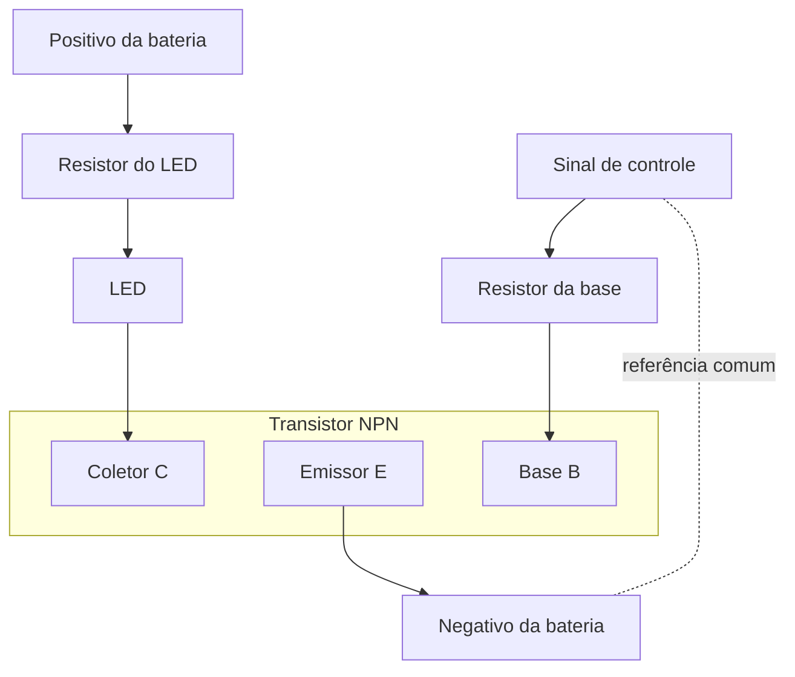
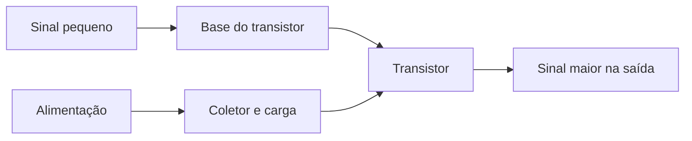

# 🔌 Transistor

Um transistor controla a passagem de corrente. Ele pode funcionar como **chave**, ligando e desligando uma carga, ou como **amplificador**, fazendo um sinal pequeno controlar um sinal maior.

### 🧩 Tipos comuns

- **BJT:** tem base (B), coletor (C) e emissor (E). Uma corrente pequena na base controla a corrente entre coletor e emissor.
- **MOSFET:** tem gate (G), drain (D) e source (S). A tensão no gate controla a corrente entre drain e source.

Os dois tipos funcionam de maneiras diferentes e não são trocados um pelo outro sem conferir o circuito e o componente.

### 🔘 Como chave

Neste exemplo conceitual de baixa tensão, o transistor NPN liga uma carga. O resistor na base limita a corrente de controle; o resistor junto ao LED limita a corrente do LED.

Sem sinal na base, o transistor fica desligado e a carga para. Com sinal passando pelo resistor da base, ele conduz e a carga acende. O sinal de controle não alimenta o LED: a energia vem da bateria ligada à carga.

### 📈 Como amplificador

Quando o transistor fica ajustado na região de amplificação, pequenas mudanças no sinal de entrada causam mudanças maiores na corrente da carga. Num amplificador simples de emissor comum, a saída é retirada do coletor; resistores e capacitores ajustam o funcionamento e acoplam o sinal.

### ⚠️ Montagem

- Confira no datasheet a ordem dos terminais: ela muda entre modelos e encapsulamentos.
- Respeite os limites de tensão, corrente e aquecimento do componente.
- Use resistor para limitar a corrente da base de um BJT e a corrente da carga.
- Para motores, relés e outras cargas com bobina, use proteção contra a tensão que aparece ao desligá-las.
- Comece com circuitos de baixa tensão; não ligue circuitos experimentais diretamente à rede elétrica.
